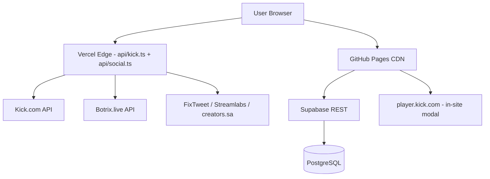

<p align="center">
  
</p>

<h1 align="center">🎮 xlxwi Stream Hub</h1>

<p align="center">
  <strong>— منصة علي الهاشمي (xlxwi) الرسمية للبث المباشر والدعم وكلان ليفل ون —</strong>
  <br>
  <em>The Official Streaming Hub for xlxwi • Kick • Clan Level One</em>
</p>

<p align="center">
  
  
  
  
  
  
</p>

<p align="center">
  <a href="https://kick.com/xlxwi">🎮 Kick</a> •
  <a href="https://discord.gg/tmfx">💬 Discord</a> •
  <a href="https://x.com/xlxwi">🐦 X</a> •
  <a href="https://github.com/hsg117/xlxwi">📦 GitHub</a>
</p>

---

## ✨ المميزات — Features

<table>
<tr>
<td width="50%" valign="top">

### 📺 Live Streaming
- **Kick Embed** player with low-latency HLS.js
- Auto-reconnect on stream drop
- Cinema mode for immersive watching
- **In-site playback** — VODs and clips open in a modal player without leaving the site

### 🏆 Chat Legends — أساطير الشات
- Live Botrix leaderboard with sort tabs (ساعات / لفل)
- Gold podium for the top 3 + ranked list
- Real Kick avatars with letter fallback

### 🫂 Support Arena — الدعم
- Two sources: **Streamlabs** and **Dokan** (creators.sa)
- All-time / monthly / weekly intervals
- **Names and ranks only** — no amounts shown
- Revealed behind a tip CTA

</td>
<td width="50%" valign="top">

### 📊 Live Social Stats
- KICK · Snapchat · Instagram · TikTok · X · WhatsApp · Discord
- Counts hide when a platform can't be read publicly
- Animated reveal on scroll

### 🛡️ Moderators
- Live X profiles via FixTweet (avatar, banner, bio, followers)
- Discord-only moderators supported
- 30-min cache + silent 10-min refresh, paused when the tab is hidden

### 🎬 Content & Tools
- **Highlight Clips** gallery and past VODs (both in-site players)
- **Stream Schedule**, **FAQ**, **Sponsors & Promo Codes**
- **Live Polls** — real-time voting
- **Announcement Bar** — scrolling ticker

### 🔐 Admin Dashboard
- **Full RBAC** — admin/editor/viewer roles
- **SEO Settings**, **Audit Logs**, **Studio Review**
- **Media Manager** — upload & organize assets

</td>
</tr>
</table>

---

## 🛠 Architecture — البنية التقنية



| Layer | Technology | Purpose |
|-------|-----------|---------|
| **Frontend** | React 19 + TypeScript + Vite 6 | SPA with instant HMR |
| **Styling** | Tailwind CSS + CSS layers | Royal burgundy & gold theme, RTL-first |
| **State** | React hooks + Supabase realtime | Live data without polling |
| **Auth** | Supabase Auth + RBAC | Secure admin access |
| **API Proxy** | Vercel Edge Function | CORS-free fetching |
| **Database** | Supabase PostgreSQL | All dynamic content |
| **Hosting** | GitHub Pages + Vercel | Static + serverless |

---

## 📁 Project Structure — هيكل المشروع

```
xlxwi/
├── api/                          # Vercel Edge Functions
│   ├── kick.ts                   #   Universal CORS proxy
│   └── social.ts                 #   Live follower counters
├── components/
│   ├── ChatLegends.tsx            #   Botrix chat leaderboard + podium
│   ├── StatsSection.tsx           #   Live stats, VODs, clips
│   ├── MediaModal.tsx             #   In-site Kick player (VOD/clip)
│   ├── ModeratorsSection.tsx      #   Mod roster from X + Discord
│   ├── StreamPlayer.tsx           #   Kick embed + HLS
│   ├── PublicWidgets.tsx          #   Schedule, FAQ, sponsors, clips
│   ├── AdminDashboard.tsx         #   Full admin panel
│   └── ...                        #   Icons, utilities & more
├── utils/                        # botrixApi, supportersApi, socialMediaApi
├── services/                     # chatService (Kick live chat)
├── public/                       # Static assets
│   ├── xlxwi-logo.webp           #   Site icon + brand mark
│   ├── bg-heraldic.webp          #   PC background — royal burgundy heraldic frame
│   ├── bg-mobile.webp            #   Phone-only background (<768px, 15 KB)
│   └── og-cover.jpg              #   Social share (OG/Twitter) image
├── App.tsx                       # Main single-page app
├── supabaseClient.ts             # Supabase singleton
├── vite.config.ts                # Vite + dev proxy config
└── README.md                     # You are here 📍
```

---

## 🚀 Quick Start — التشغيل السريع

### Prerequisites
- **Node.js** 18+ (for Vite & Vercel Edge)
- **npm** 9+
- **Git**

### Installation

```bash
# Clone the repository
git clone https://github.com/hsg117/xlxwi.git
cd xlxwi

# Install dependencies
npm install

# Start development server (http://localhost:3003)
npm run dev

# Build for production (Vercel / any root-domain host)
npm run build

# Preview production build
npm run preview
```

### Deploy to Vercel — النشر على فيركل

`vercel.json` يهيّئ كل شيء (Vite + `dist` + دوال `api/`). اربط المستودع بـ Vercel مباشرة، أو:

```bash
npm i -g vercel
vercel --prod
```

> **مهم:** بيانات كيك وشات كيك تمرّ عبر دالة `api/kick.ts`. هذه لا تعمل على GitHub Pages
> (لا توجد دوال سيرفر هناك)، فالموقع يحتاج **Vercel** أو أي مستضيف يدعمها.
> النطاق الحالي في وسوم `canonical` و`og:url` و`sitemap.xml` هو `https://xlxwi.vercel.app/` —
> غيّره إن أعطى Vercel مشروعك اسماً مختلفاً.

### Deploy to GitHub Pages (بدون دوال — الشات وأرقام كيك تتعطل)

```bash
# One command — builds + deploys (base path /xlxwi/)
npm run deploy
```

---

## 🔧 Configuration — الإعدادات

### Supabase
Edit `supabaseClient.ts`:
```ts
const supabaseUrl = 'https://your-project.supabase.co';
const supabaseKey = 'your-anon-key';
```

### Identity & Social Links
All identity lives at the top of `App.tsx`:
```ts
const CHANNEL_SLUG = 'xlxwi';
const BRAND_LOGO = 'xlxwi-logo.webp';
const SITE_BACKGROUND = 'bg-heraldic.webp';
const CLAN = { latin: 'LEVEL ONE', ar: 'كلان ليفل ون', tag: '#StayOne' };
```
`createSocialLink()` covers Snapchat, Instagram, TikTok, X, WhatsApp and Discord; KICK is the `KICK_SOCIAL` constant.

### Leaderboard Sources
| Source | Endpoint | File |
|--------|----------|------|
| **Botrix** | `https://botrix.live/api/public/leaderboard?platform=kick&user=xlxwi` | `utils/botrixApi.ts` |
| **Streamlabs** | `https://streamlabs.com/api/v6/{id}/leaderboard/tip` | `utils/supportersApi.ts` |
| **Dokan** | `https://api.creators.sa/v1/kebab/unified/xlxwi/leaderboard` | `utils/supportersApi.ts` |
| **Social counts** | handles `xlxwi` / `3.4i` | `api/social.ts` + mirrored in `vite.config.ts` |

---

## 🎯 Key Components Breakdown

### 🏆 ChatLegends (`components/ChatLegends.tsx`)
- Fetches Botrix and converts watchtime (minutes) to hours
- Two sort tabs — الأكثر ساعات / الأعلى لفل
- Podium for the top 3, scrollable ranked list below

### 📊 StatsSection (`components/StatsSection.tsx`)
- Live stat cards + VOD and clip grids
- Every card calls `onPlay()` → opens `MediaModal`, so playback never leaves the site

### 🎬 MediaModal (`components/MediaModal.tsx`)
- `https://player.kick.com/xlxwi?video={id}` and `?clip={id}`
- ESC to close, body scroll lock, loading spinner

### 🛡️ ModeratorsSection (`components/ModeratorsSection.tsx`)
- `ROSTER` — each entry has a Kick name plus an optional X handle or `discordId`
- Discord-only moderators show the invite button instead of an X profile

### 🔐 AdminDashboard (`components/AdminDashboard.tsx`)
- Tabs: Overview, Announcements, Sponsors, Clips, Studio Review, Schedule, FAQs, SEO, Admins, Audit, Media
- Supabase CRUD for every content type

---

## 💾 Database Schema — هيكل قاعدة البيانات

| Table | Purpose |
|-------|---------|
| `social_links` | Platform URLs + follower counts |
| `announcements` | Scrolling ticker + toggles |
| `sponsors` | Brand promo codes |
| `highlight_clips` | Video gallery |
| `schedule` | Weekly stream plan |
| `faqs` | Q&A entries |
| `seo_settings` | Meta tags |
| `polls` | Live voting |
| `admin_users` | RBAC controls |
| `audit_logs` | Activity trail |
| `media_assets` | Image/video/link library |
| `studio_submissions` | Community content |
| `daily_views` | Visitor analytics |

---

## 🤝 Contributing — المساهمة

1. Fork the repository
2. Create a feature branch (`git checkout -b feature/amazing`)
3. Commit your changes (`git commit -m 'Add amazing feature'`)
4. Push to the branch (`git push origin feature/amazing`)
5. Open a Pull Request

### Guidelines
- Follow the existing code style (inline Tailwind, functional components)
- Test with `npm run build` before submitting
- Keep the burgundy/gold palette: gold = accent and rank, crimson = fills, Kick green only on the Kick brand mark

---

## 📬 Contact — التواصل

| Channel | Info |
|---------|------|
| 🎮 **Kick** | [xlxwi](https://kick.com/xlxwi) |
| 🐦 **X** | [@xlxwi](https://x.com/xlxwi) |
| 📸 **Instagram** | [@3.4i](https://www.instagram.com/3.4i/) |
| 🎵 **TikTok** | [@xlxwi](https://www.tiktok.com/@xlxwi) |
| 👻 **Snapchat** | [@xlxwiii](https://www.snapchat.com/@xlxwiii) |
| 💬 **Discord** | [Clan Level One](https://discord.gg/tmfx) |
| 📣 **WhatsApp** | [Channel](https://www.whatsapp.com/channel/0029VadcjLc4Y9lnhHoOAw0a) |
| 🛠 **Site Author** | [Moh_HSG](https://discord.com/users/1416151331965767810) |

---

## 📜 License — الترخيص

```
© 2026 xlxwi Stream Hub. All Rights Reserved.
POWERED BY HSG
```

<p align="center">
  <strong>POWERED BY HSG</strong>
</p>
