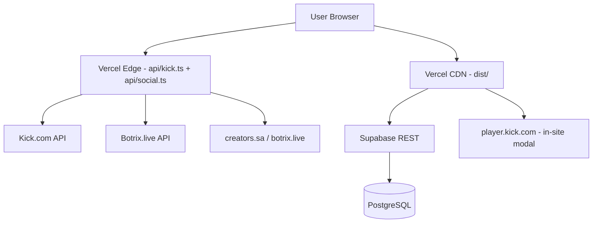

<p align="center">
  
</p>

<h1 align="center">🎮 TMNAA Stream Hub</h1>

<p align="center">
  <strong>— منصة عبدالله الشمري (TMNAA) الرسمية للبث المباشر والدعم وكلان ليفل ون —</strong>
  <br>
  <em>The Official Streaming Hub for TMNAA • Kick • Clan Level One</em>
</p>

<p align="center">
  
  
  
  
  
</p>

<p align="center">
  <a href="https://kick.com/tmnaa">🎮 Kick</a> •
  <a href="https://discord.gg/tmfx">💬 Discord</a> •
  <a href="https://x.com/tmnaa16">🐦 X</a> •
  <a href="https://github.com/himedd/tmnaa">📦 GitHub</a>
</p>

---

## ✨ المميزات — Features

<table>
<tr>
<td width="50%" valign="top">

### 📺 Live Streaming
- **Kick Embed** player with low-latency HLS.js
- Auto-reconnect on stream drop
- Cinema mode for immersive watching
- **In-site playback** — VODs and clips open in a modal player without leaving the site

### 🏆 Chat Legends — أساطير الشات
- Live Botrix leaderboard with sort tabs (ساعات / لفل)
- Gold podium for the top 3 + ranked list
- Real Kick avatars with letter fallback

### 🫂 Support Arena — الدعم
- Single live source: **Dokan** (creators.sa) — Streamlabs has no public leaderboard API
- One tip gate: a single wide **دعم** button straight to Dokan — no competing vendor cards
- All-time / monthly / weekly intervals
- **Names and ranks only** — no amounts shown
- Revealed behind a tip CTA

</td>
<td width="50%" valign="top">

### 📊 Live Social Stats
- KICK · Instagram · TikTok · X · WhatsApp · Discord · YouTube
- Every platform is read live server-side; the last good number is cached so a card never goes blank
- Animated reveal on scroll

### 🛡️ Moderators
- Live Kick channels (avatar, banner, bio, real follower count, verified + LIVE badges)
- Local avatar per mod as the offline fallback
- 30-min cache + silent 10-min refresh, paused when the tab is hidden

### 🎬 Content & Tools
- **Highlight Clips** gallery and past VODs (both in-site players)
- **Stream Schedule**, **FAQ**, **Sponsors & Promo Codes**
- **Live Polls** — real-time voting
- **Announcement Bar** — scrolling ticker

### 🔐 Admin Dashboard
- **Full RBAC** — admin/editor/viewer roles
- **SEO Settings**, **Audit Logs**, **Studio Review**
- **Media Manager** — upload & organize assets

</td>
</tr>
</table>

---

## 🛠 Architecture — البنية التقنية



| Layer | Technology | Purpose |
|-------|-----------|---------|
| **Frontend** | React 19 + TypeScript + Vite 6 | SPA with instant HMR |
| **Styling** | Tailwind CSS + CSS layers | Midnight blue & gold theme, RTL-first |
| **State** | React hooks + Supabase realtime | Live data without polling |
| **Admin** | Supabase RLS + `seo_settings` / admin tables | Editor access guarded by the database policy |
| **API Proxy** | Vercel Edge Function | CORS-free fetching, host allowlist |
| **Database** | Supabase PostgreSQL | All dynamic content |
| **Hosting** | Vercel | Static `dist` + serverless edge functions |

---

## 📁 Project Structure — هيكل المشروع

```
tmnaa/
├── api/                          # Vercel Edge Functions
│   ├── kick.ts                   #   CORS proxy — https + allowlisted hosts only
│   └── social.ts                 #   Live follower counters (kick/tiktok/ig/x/discord/yt)
├── components/
│   ├── ChatLegends.tsx            #   Botrix chat leaderboard + podium
│   ├── StatsSection.tsx           #   Live stats, VODs, clips
│   ├── MediaModal.tsx             #   In-site Kick player (VOD/clip)
│   ├── ModeratorsSection.tsx      #   Mod roster: X accounts + one Discord card
│   ├── StreamPlayer.tsx           #   Kick embed + HLS
│   ├── PublicWidgets.tsx          #   Schedule, FAQ, sponsors, clips
│   └── ...                        #   Icons, chat and utilities
├── utils/                        # botrixApi, supportersApi, socialMediaApi
├── services/                     # chatService (Kick live chat)
├── public/                       # Static assets
│   ├── tmnaa-logo.webp           #   Site icon + brand mark
│   ├── bg-heraldic.webp          #   Desktop background — castle-night scene (16:9)
│   ├── bg-mobile.webp            #   Phone-only background (<768px)
│   ├── og-cover.jpg              #   Social share (OG/Twitter) image — 1200×630
│   ├── site.webmanifest          #   PWA manifest (ar / rtl)
│   └── ps5-giveaway.html         #   Standalone giveaway page — /ps5-giveaway.html
├── App.tsx                       # Main single-page app
├── supabaseClient.ts             # Supabase singleton
├── vite.config.ts                # Vite + dev proxy config
└── README.md                     # You are here 📍
```

---

## 🚀 Quick Start — التشغيل السريع

### Prerequisites
- **Node.js** 18+ (for Vite & Vercel Edge)
- **npm** 9+
- **Git**

### Installation

```bash
# Clone the repository
git clone https://github.com/himedd/tmnaa.git
cd tmnaa

# Install dependencies
npm install

# Start development server (http://localhost:3000)
# vite.config.ts mounts api/kick.ts and api/social.ts as dev middleware,
# so the site behaves exactly like it does on Vercel
npm run dev

# Build for production (Vercel / any root-domain host)
npm run build

# Preview production build
npm run preview
```

### Deploy to Vercel — النشر على فيركل

`vercel.json` يهيّئ كل شيء: Vite + `dist` + دوال `api/` + كاش الأصول + ترويسات الأمان. خطوات النشر:

1. **Import** المستودع `himedd/tmnaa` في Vercel — لا تحتاج تعديل أي حقل، `vercel.json` يضبط البناء.
2. **Environment Variables** (Project → Settings → Environment Variables):

   | المتغير | ضروري؟ | الوظيفة |
   |---------|--------|---------|
   | `VITE_SUPABASE_URL` | اختياري | الرعاة، المقاطع، الجدول، الأسئلة، الاستطلاع |
   | `VITE_SUPABASE_ANON_KEY` | اختياري | مفتاح anon العام — يُطبع في حزمة المتصفح anyway |

   بلاهما يشتغل الموقع ببياناته الافتراضية المحفوظة في الكود — لا شاشة سوداء ولا خطأ بناء.
3. **الدومين**: وسوم `canonical` و`og:url` و`sitemap.xml` تشير إلى `https://tmnaa.vercel.app/` — بدّلها إن أعطى Vercel مشروعك اسماً آخر.

> **مهم:** أرقام كيك والشات الحيّ يمرّان عبر دالة `api/kick.ts`، وهي لا تعمل على GitHub Pages
> (لا توجد دوال سيرفر هناك)، فالموقع يحتاج **Vercel** أو أي مستضيف يدعم دوال Node/Edge.
> لا تضع أي سر في متغيرات `VITE_` — كل ما يبدأ بـ`VITE_` يُخبَز داخل جافاسكربت العام لحظة البناء.

---

## 🔧 Configuration — الإعدادات

### Supabase

`supabaseClient.ts` يقرأ المتغيرات البيئية ولا يحتوي أي مفتاح:

```ts
const supabaseUrl = import.meta.env.VITE_SUPABASE_URL || '';
const supabaseKey = import.meta.env.VITE_SUPABASE_ANON_KEY || '';
```

محلياً: انسخ `.env.example` إلى `.env` واملأ القيمتين (`.env` خارج Git). على Vercel: من إعدادات المشروع.
بدونهما يرجع العميل بديلاً يمتص الاستدعاءات، فتظهر البيانات الافتراضية بدل الشاشة السوداء.
مخطّط الجداول في `database/*.sql` و`SUPABASE_SQL.sql`.

### Identity & Social Links
All identity lives at the top of `App.tsx`:
```ts
const CHANNEL_SLUG = 'tmnaa';
const BRAND_LOGO = 'tmnaa-logo.webp';
const SITE_BACKGROUND = 'bg-heraldic.webp';
const CLAN = { latin: 'LEVEL ONE', ar: 'كلان ليفل ون', tag: '#StayOne' };
```
`createSocialLink()` covers Instagram, TikTok, X, WhatsApp, Discord and YouTube; KICK is the `KICK_SOCIAL` constant.

### Leaderboard Sources
| Source | Endpoint | File |
|--------|----------|------|
| **Botrix** | `https://botrix.live/api/public/leaderboard?platform=kick&user=tmnaa` | `utils/botrixApi.ts` |
| **Dokan** | `https://api.creators.sa/v1/kebab/unified/tmnaa/leaderboard` | `utils/supportersApi.ts` |
| **Social counts** | `tmnaa` · `tmnaa16` · `tmnaa1` · `tmnaa0` · `tmfx` | `api/social.ts`, mirrored in `utils/socialMediaApi.ts` |

---

## 🎯 Key Components Breakdown

### 🏆 ChatLegends (`components/ChatLegends.tsx`)
- Fetches Botrix and converts watchtime (minutes) to hours
- Two sort tabs — الأكثر ساعات / الأعلى لفل
- Podium for the top 3, scrollable ranked list below

### 📊 StatsSection (`components/StatsSection.tsx`)
- Live stat cards + VOD and clip grids
- Every card calls `onPlay()` → opens `MediaModal`, so playback never leaves the site

### 🎬 MediaModal (`components/MediaModal.tsx`)
- `https://player.kick.com/tmnaa?video={id}` and `?clip={id}`
- ESC to close, body scroll lock, loading spinner

### 🛡️ ModeratorsSection (`components/ModeratorsSection.tsx`)
- `ROSTER` — nine **X** accounts plus one **Discord-only** card; the entry flagged `lead` (YARA) renders as the crowned hero card above the grid
- Live counters, verified badge and bio come from `api.fxtwitter.com/<handle>` (it sends CORS headers, so the browser calls it directly) — only entries with `x` are fetched; a `discord: { user }` entry links to `discord.com/users/<id>` and hides the follower chip, because Discord exposes no public counter
- `noPic: true` marks an account still wearing X's default grey egg — the card falls back to its gold initial instead
- `frame` is a decorative animated WebP laid exactly over the avatar square (Discord collectible frames are square art: ears in the corners, whiskers on the edges), so the frame box and the avatar box share one size and origin
- Avatars and banners are pulled live from X's CDN (`pbs.twimg.com`, hot-linkable) and refresh silently every 5 min; `public/mods/` keeps a local copy plus a seeded follower count so a card is never blank if the API fails
- A moderator without a banner gets `CrestBand` — a gold-on-navy crest strip instead of empty space
- The lead card's crown is static vector art at `public/crown.svg`, seated on the avatar — no sway, no sheen; the card's only motion is the ambient sparkles and the portrait ring

### 🗄 Content editing — تعديل المحتوى
- النسخة المنشورة **لا تحمل أي لوحة تحكم**: لا مسار `/admin` ولا مكوّن admin موصول بـ`App.tsx`، فلا سطح هجوم إضافي
- التعديل يتم مباشرة على جداول Supabase (`database/*.sql` و`SUPABASE_SQL.sql`) — الرعاة، المقاطع، الجدول، الأسئلة، الاستطلاع
- صف `seo_settings` (id = 1) يعيد كتابة العنوان والوصف والكلمات المفتاحية و`og:title`/`og:description` لحظة التشغيل، فهو يتجاوز `index.html` (تفصيله في قسم SEO)
- `admin_users` + سياسات RLS جاهزة في `database/add_admin_user.sql` إن خُطّط لاحقاً لواجهة تحرير

---

## 🔒 Security — الأمان

| النقطة | الوضع |
|--------|-------|
| أسرار في المستودع | لا شيء. `.env` و`.env.*` خارج Git، والمُتبَّع الوحيد `.env.example` بقيمة فارغة |
| مفاتيح Supabase | تُقرأ من `VITE_*` فقط (مفتاح anon عام بطبيعته). لا يوجد `service_role` في الكود |
| `api/kick.ts` | بروكسي مفتوح للعامة، لذا يُسمح بـ`https:` فقط ولنطاقات معلومة (`kick.com`, `botrix.live`, `api.creators.sa`) — بدونه يتحول لممر SSRF يستهلك رصيد فيركل |
| `api/social.ts` | لا يمرّر أي عنوان من المستخدم: المنصة تُفحص ضد قائمة ثابتة ثم يبنى الرابط داخلياً |
| مسارات الإدارة | لا مسار admin منشور — لا صفحة ولا دالة |
| ترويسات فيركل | `nosniff`، `X-Frame-Options: DENY` + `frame-ancestors 'none'`، `Referrer-Policy: strict-origin-when-cross-origin`، `Permissions-Policy` مقفلة (كاميرا/ميك/جغرافيا/دفع/USB) |
| `vite.config.ts` | لا `define` يحقن متغيرات سيرفرية في حزمة المتصفح — كان فيه بقايا `GEMINI_API_KEY` تُطبَع علناً لو وُجدت |
| صور المشرفين | تُسحب من CDN إكس العام، ومحفوظة نسخ محلية في `public/mods/` — لا كوكيز ولا تسجيل دخول |

---

## 🔎 SEO & Share Preview — الفهرسة وصورة المشاركة

Everything the crawler reads ships in the static `index.html`, so it works with JavaScript off:

| Piece | Where | Notes |
|-------|-------|-------|
| Title / description | `index.html` | Arabic-first, sized to Google's limits (≤60 / ≤160 chars) |
| OG + Twitter tags | `index.html` | `summary_large_image`, `og:image:alt` + `twitter:image:alt` describe the artwork |
| Share image | `public/og-cover.jpg` | 1200×630, ~112 KB — castle background, gold-foil `TMNAA`, crown, platform chips, `#StayOne / كلان ليفل ون` |
| Structured data | `index.html` | JSON-LD `@graph`: `Person` + `WebSite` + `ItemList` of the page sections |
| hreflang | `index.html` | `ar` + `x-default` — one page serves both languages through the in-app switch |
| PWA manifest | `public/site.webmanifest` | `lang: ar`, `dir: rtl`, `standalone`, maskable icons |
| `noscript` content | `index.html` (in `<body>`) | Real `<h1>`, description and section links. Vite rejects block content inside a `<head>` `<noscript>`, so it must live in the body |
| Robots / sitemap | `public/robots.txt`, `public/sitemap.xml` | Canonical host is `https://tmnaa.vercel.app/` |

> **`seo_settings` override:** the admin panel's `seo_settings` row (id = 1) rewrites `document.title`,
> `description`, `keywords`, `og:title` and `og:description` at runtime. Empty fields are ignored —
> a blank row can no longer wipe the shipped head — but anything you *do* fill in wins over
> `index.html`. Keep that row in sync with the static tags, or leave it empty.

### Weight & smoothness — الخفة والنعومة
- Below-the-fold sections are code-split (`StatsSection`, `ModeratorsSection`, `LiveTheater`, `MediaModal`) and `vendor-hls` only loads with the player.
- Fonts load once from Google with `preconnect` + `display=swap`; the stack lists only families the site actually requests (Outfit 900, Tajawal 500/700/900, Cairo 500/700/900, Bangers).
- Badge/crest art is delivered at ≈3× its rendered size, not 5–8× — `dokan-gate`, `dokan-mark`, `level-one-mark` and `mohhsg-icon` were re-encoded down to 22 KB combined.
- The hero wordmark is `white-space: nowrap` and size-capped so it stays on one line inside its column in both the loaded font and the fallback.

---


## 💾 Database Schema — هيكل قاعدة البيانات

| Table | Purpose |
|-------|---------|
| `social_links` | Platform URLs + follower counts |
| `announcements` | Scrolling ticker + toggles |
| `sponsors` | Brand promo codes |
| `highlight_clips` | Video gallery |
| `schedule` | Weekly stream plan |
| `faqs` | Q&A entries |
| `seo_settings` | Meta tags |
| `polls` | Live voting |
| `admin_users` | RBAC controls |
| `audit_logs` | Activity trail |
| `media_assets` | Image/video/link library |
| `studio_submissions` | Community content |
| `daily_views` | Visitor analytics |

---

## 🤝 Contributing — المساهمة

1. Fork the repository
2. Create a feature branch (`git checkout -b feature/amazing`)
3. Commit your changes (`git commit -m 'Add amazing feature'`)
4. Push to the branch (`git push origin feature/amazing`)
5. Open a Pull Request

### Guidelines
- Follow the existing code style (inline Tailwind, functional components)
- Test with `npm run build` before submitting
- Keep the midnight-blue/gold palette: gold = accent and rank, azure = fills, Kick green only on the Kick brand mark

---

## 📬 Contact — التواصل

| Channel | Info |
|---------|------|
| 🎮 **Kick** | [kick.com/tmnaa](https://kick.com/tmnaa) |
| 🐦 **X** | [@tmnaa16](https://x.com/tmnaa16) |
| 📸 **Instagram** | [@tmnaa16](https://www.instagram.com/tmnaa16) |
| 🎵 **TikTok** | [@tmnaa0](https://www.tiktok.com/@tmnaa0) |
| ▶️ **YouTube** | [@tmnaa1](https://www.youtube.com/@tmnaa1) |
| 💬 **Discord** | [discord.gg/tmfx](https://discord.gg/tmfx) |
| 📣 **WhatsApp** | [قناة TMNAA](https://www.whatsapp.com/channel/0029VadcjLc4Y9lnhHoOAw0a) |
| 💰 **Dokan** | [tip.dokan.sa/tmnaa](https://tip.dokan.sa/tmnaa) |
| 🛠 **Site Author** | [Moh_HSG](https://discord.com/users/1416151331965767810) |

---

## 📜 License — الترخيص

```
© 2026 TMNAA Stream Hub. All Rights Reserved.
POWERED BY HSG
```

<p align="center">
  <strong>POWERED BY HSG</strong>
</p>
